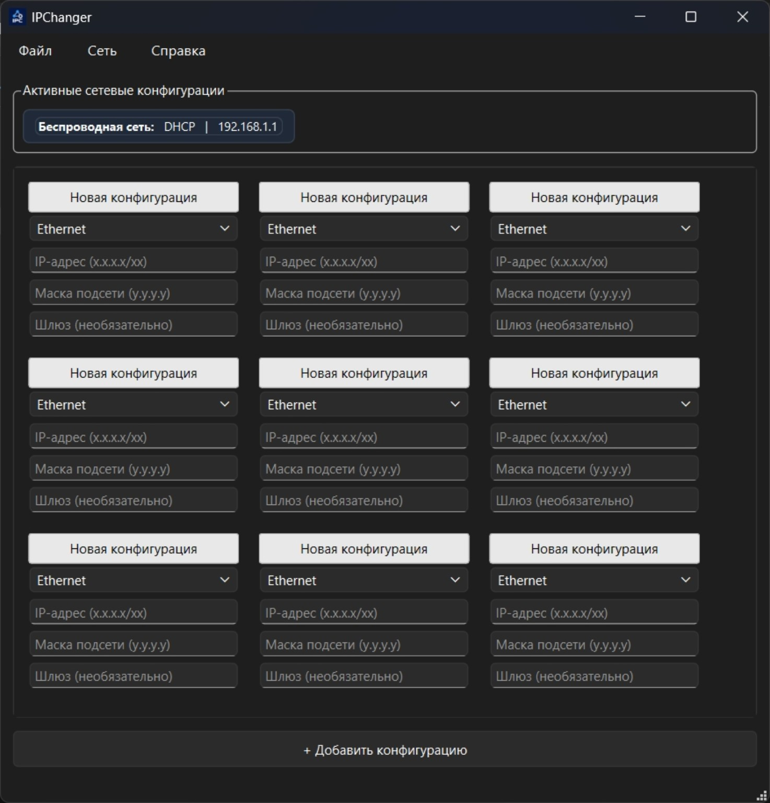

<div align="center">

# 🌐 IPChanger

**Fast, reusable IPv4 network profiles for Windows.**

Create, save, and switch between static IPv4 and DHCP configurations without repeatedly opening Windows network settings.


[](LICENSE)

[Features](#-features) · [Getting started](#-getting-started) · [Usage](#-usage) · [Shortcuts](#-keyboard-shortcuts) · [Contributing](#-contributing)

</div>

## 📸 Screenshot



> The application UI is currently in Russian. This README is in English.

## ✨ Features

### Network profiles

- **One-action profile switching:** double-click a profile header to apply its settings.
- **Static IPv4 and DHCP:** choose a network adapter, IP address, subnet mask, and optional gateway, or switch the profile to DHCP.
- **Reusable profiles:** create, rename, clone, delete, import, and save configuration sets as JSON.
- **Create from an active adapter:** right-click an active connection to copy its detected settings into a new profile.
- **CIDR input:** enter `192.168.10.25/24` to fill the subnet mask and suggest a gateway. Always verify the suggested gateway.
- **Convenient input correction:** commas and Cyrillic `ю` / `Ю` entered in address fields are automatically converted to dots.
- **Subnet overlap detection:** checks the proposed subnet against other detected active IPv4 interfaces before applying it.

### Network tools

- **Active connections panel:** view detected active physical adapters, IPv4/CIDR information, and gateways.
- **Ping gateways:** choose an active adapter under **Сеть → Пинг** (*Network → Ping*), or use the right-click menu on an active connection.
- **Windows console diagnostics:** ping and `ipconfig /all` open in separate CMD windows.
- **Adapter controls:** enable or disable an adapter from a profile's context menu.
- **IPv4 subnet mask reference:** open **Сеть → Маски** (*Network → Masks*) for subnet masks, CIDR prefixes, and address counts (`/8` through `/32`).
- **Background refresh:** network discovery runs on a Qt worker thread; press `F5` to refresh.

### Interface

- **Adaptive layout:** profile and active-adapter cards reflow with the window width.
- **Color-coded profile headers:** green for matching active settings, gray for inactive/non-matching profiles, and red for a mismatch on a connected adapter.
- **Theme-aware subnet mask table:** colors adapt to light and dark Windows palettes.

> **Note:** Status colors reflect the last network refresh, not continuous real-time monitoring.

## 🧰 Requirements

- Windows with Windows PowerShell, `netsh`, and `cmd.exe`.
- Python 3.10+ recommended.
- [PySide6](https://pypi.org/project/PySide6/) (Qt for Python).
- **Administrator privileges** to apply network settings or enable/disable adapters.

IPChanger currently targets **Windows only**. The network-management backend is not compatible with Linux or macOS.

## 🚀 Getting started

### 1. Clone the repository

```powershell
git clone https://github.com/MrBorodaX/IPchanger.git
cd IPchanger
```

Alternatively, download the repository ZIP from GitHub.

### 2. Create a virtual environment

```powershell
py -m venv .venv
.\.venv\Scripts\Activate.ps1
```

If your PowerShell execution policy prevents activation, use `.\.venv\Scripts\python.exe` directly in the commands below.

### 3. Install PySide6

```powershell
python -m pip install PySide6
```

The repository does not currently contain a `requirements.txt`; PySide6 is the only third-party Python package imported by the application.

### 4. Run the application

```powershell
python main.py
```

To change adapter settings, start **PowerShell as Administrator** before running IPChanger. Without elevation, the application warns you and offers to continue with restricted functionality.

> [!WARNING]
> Applying a network profile can interrupt your connection. If you are working over Remote Desktop, VPN, or another remote session, make sure you have a recovery path before changing network settings.

## 📖 Usage

### Create and apply a static profile

1. Click **+ Добавить конфигурацию** (*Add configuration*).
2. Select the target network adapter.
3. Enter an IPv4 address, for example `192.168.10.25`.
4. Enter `255.255.255.0` as the mask and, optionally, `192.168.10.1` as the gateway.
5. Right-click the profile header and choose **Изменить** (*Rename*) to give it a useful name.
6. **Double-click the profile header** to apply the settings, or choose **Применить** (*Apply*) from its context menu.

**CIDR shortcut:** entering `192.168.10.25/24` automatically populates the subnet mask and proposes `192.168.10.1` as a gateway. The proposed gateway is only a convenience, not a guarantee that the address belongs to your router.

### Switch an adapter to DHCP

Right-click a profile header, choose **DHCP**, then double-click the header to apply it. The profile stores `DHCP` in its IP, mask, and gateway fields; Windows is switched to automatic IPv4 addressing when the profile is applied.

### Create a profile from the current network

Right-click a card in the **Активные сетевые конфигурации** (*Active network configurations*) panel and select **Создать конфигурацию** (*Create configuration*). IPChanger creates a new profile using the detected adapter settings.

### Profile context menu

| Russian menu item | English meaning | Action |
| --- | --- | --- |
| Изменить | Rename | Change the profile name |
| Применить | Apply | Apply settings to the selected adapter |
| Удалить | Delete | Remove the profile after confirmation |
| Клонировать | Clone | Duplicate the profile with a unique name |
| DHCP | DHCP | Prepare automatic IPv4 configuration |
| Пинговать | Ping | Open a CMD window to ping the gateway or selected address |
| Включить | Enable | Enable the selected adapter |
| Отключить | Disable | Disable the selected adapter |

### Network utilities

- **Сеть → Пинг:** select a detected active adapter's gateway to ping it in a separate console window.
- **Сеть → Маски:** view a built-in IPv4 subnet mask/CIDR reference table.
- **Сеть → IPConfig:** open `ipconfig /all` in a separate CMD window.
- **Сеть → Обновить интерфейсы:** refresh detected adapters and active IPv4 information.

## ⌨️ Keyboard shortcuts

| Shortcut | Action |
| --- | --- |
| `Ctrl+N` | Create a new configuration set |
| `Ctrl+O` | Open a JSON configuration file |
| `Ctrl+S` | Save the current configuration set |
| `Ctrl+Shift+S` | Save as another JSON file |
| `F5` | Refresh network adapters |
| `Ctrl+I` | Open `ipconfig /all` |
| `F1` | Show in-app help |
| `Alt+F4` | Exit |

## 💾 Configuration files

Profiles are saved in `configurations.json` by default. You can open a different JSON file or save the current set to a new file using the **Файл** (*File*) menu.

Example:

```json
{
  "window_size": {
    "width": 1100,
    "height": 750
  },
  "configs": [
    {
      "name": "Lab network",
      "interface": "Ethernet",
      "ip": "192.168.10.25",
      "mask": "255.255.255.0",
      "gateway": "192.168.10.1"
    }
  ]
}
```

Profiles are saved during certain editing actions and when the application closes. **Saving a profile is not the same as applying it to Windows.**

> [!CAUTION]
> In v3.0.1, JSON is written directly to the destination file, not via an atomic replacement. Also, the current loader deletes an unreadable JSON file. **Back up important configuration files** before upgrading or editing them externally.

## 🏗️ How it works

| Component | Responsibility |
| --- | --- |
| `MainWindow` | Main window, menus, adaptive layouts, and file operations |
| `ConfigWidget` | Editable IPv4 profile cards and profile actions |
| `ActiveConfigWidget` | Active-adapter cards and context-menu actions |
| `NetworkManager` | PowerShell discovery, `netsh` configuration, and CMD diagnostics |
| `NetworkRefreshWorker` | Network discovery outside the GUI thread |
| `ConfigManager` | JSON configuration persistence |

IPChanger queries physical network adapters using Windows PowerShell (`Get-NetAdapter`, `Get-NetIPAddress`, `Get-NetRoute`) and applies IPv4 changes using `netsh`. The Python standard-library `ipaddress` module handles CIDR calculations and subnet overlap checks.

## 📦 Build an executable (optional)

You can try packaging the app with [PyInstaller](https://pyinstaller.org/):

```powershell
python -m pip install pyinstaller
python -m PyInstaller --onefile --windowed --name IPChanger --icon icon.ico --add-data "icon.ico;." main.py
```

The executable will be placed in `dist\IPChanger.exe`.

> This is a **suggested, unverified build command**, not an official tested release. The current source loads `icon.ico` relative to `main.py`; in a one-file build, the application window icon may require a runtime resource-path adjustment. Test the result before distribution.

## 🔧 Troubleshooting

| Problem | What to check |
| --- | --- |
| Cannot apply settings | Run as Administrator; verify the adapter and IP settings |
| Adapter is missing | Press `F5`; discovery currently queries physical adapters only |
| Profile does not turn green | Refresh the network state and compare IP, mask, and gateway |
| Subnet overlap warning | Another detected active interface uses an overlapping subnet |
| Connection drops after applying | Check adapter selection, IP, mask, and gateway; restore the previous profile or DHCP as appropriate |
| App opens without an icon | Check that `icon.ico` is next to `main.py` |

## ⚠️ Known limitations

- Windows only; the interface is currently in Russian.
- IPv4 configuration only; no IPv6 profile editor.
- Only physical adapters are discovered by the current PowerShell query.
- Refresh is on demand and after certain actions, not continuous monitoring.
- No automatic rollback when a network change disconnects the computer.
- Configuration-file loading and saving have the data-safety limitations described above.

## 🤝 Contributing

Bug reports, improvements, and pull requests are welcome.

1. Check [existing issues](https://github.com/MrBorodaX/IPchanger/issues).
2. For a bug report, include Windows version, reproduction steps, expected versus actual behavior, and any relevant error messages. Redact private network details from screenshots and logs.
3. For code changes, create a focused branch and open a pull request with a short description of your changes and how you tested them.

## 📄 License

This project is licensed under the **GNU General Public License v3.0**. See the [LICENSE](LICENSE) file for details.

Copyright © 2026 [MrBorodaX](https://github.com/MrBorodaX).

---

<div align="center">

Made by **[MrBorodaX](https://github.com/MrBorodaX)** · If IPChanger helps you, consider starring the repository ⭐

</div>
